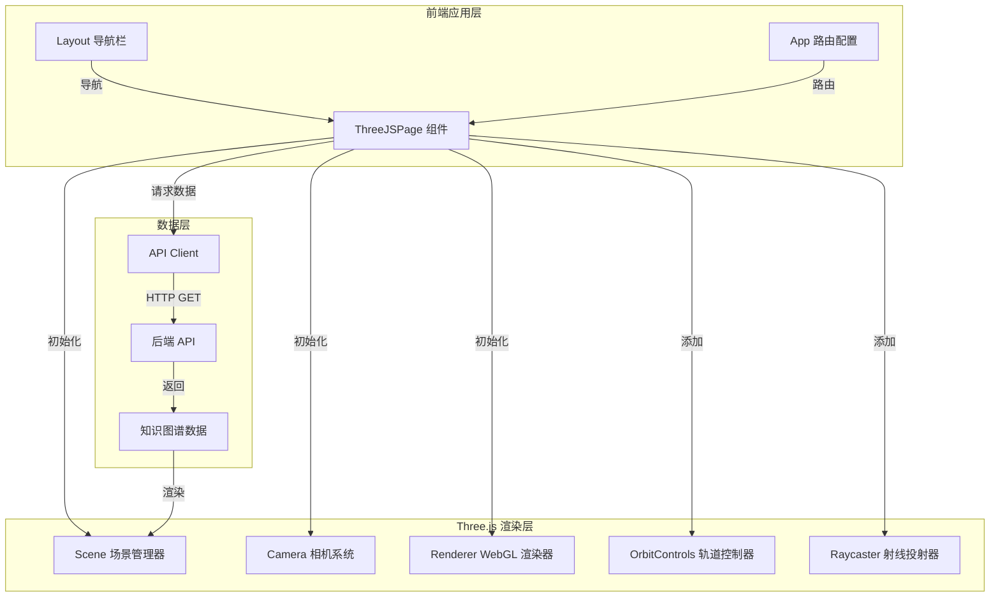

# 3D 知识图谱可视化 - 技术设计文档

## 1. 概述

### 1.1 设计目标
基于 Three.js 构建交互式 3D 知识图谱可视化系统，提供从基础演示到完整 3D 图谱的渐进式实现方案。系统将在现有的 Feynman 平台基础上，新增独立的 3D 可视化页面，与现有的 2D ECharts 图谱页面并存。

### 1.2 核心技术栈
- **3D 渲染**：Three.js (r161+)
- **前端框架**：React 18+ with Hooks
- **路由管理**：React Router DOM v7
- **HTTP 客户端**：Axios
- **构建工具**：Vite

### 1.3 设计原则
- **渐进式实现**：从简单立方体 → 3D 图谱 → 高级交互
- **资源优化**：正确管理 Three.js 资源生命周期，避免内存泄漏
- **用户体验**：提供流畅的 60fps 动画和直观的交互反馈
- **可维护性**：保持代码结构清晰，与现有代码风格一致

---

## 2. 架构设计

### 2.1 系统架构图



### 2.2 文件结构

```
feynman-platform-frontend/
├── src/
│   ├── pages/
│   │   ├── ThreeJSPage.jsx          # 新增：3D 场景主页面
│   │   └── GraphPage.jsx            # 现有：2D ECharts 图谱页面
│   ├── components/
│   │   └── Layout.jsx               # 修改：添加"3D 视界"导航链接
│   ├── api/
│   │   └── axios.js                 # 现有：API 客户端
│   └── App.jsx                      # 修改：添加 /3d-world 路由
├── package.json                      # 修改：添加 three 依赖
└── ...
```

### 2.3 实现阶段划分

**阶段一：基础 3D 场景（旋转立方体）**
- 目标：验证 Three.js 集成和基础交互
- 输出：可交互的旋转立方体演示

**阶段二：3D 知识图谱渲染**
- 目标：将图谱数据映射到 3D 空间
- 输出：带光照的 3D 知识星球网络

**阶段三：高级交互（挑战功能）**
- 目标：实现鼠标悬停高亮
- 输出：完整的交互式 3D 知识宇宙

---

## 3. 组件与接口设计

### 3.1 ThreeJSPage 组件

**职责：**
- 管理 Three.js 场景的完整生命周期
- 从 API 获取图谱数据
- 处理用户交互事件
- 协调渲染器、相机、控制器

**状态管理：**
```javascript
const [graphData, setGraphData] = useState({ nodes: [], links: [] });
const mountRef = useRef(null);  // 3D 容器 DOM 引用
const sceneRef = useRef(null);  // Three.js 场景引用
const cameraRef = useRef(null); // 相机引用
const rendererRef = useRef(null); // 渲染器引用
const nodeObjectsRef = useRef(new Map()); // 节点对象映射表
const hoveredObjectRef = useRef(null); // 当前悬停对象
const mouseRef = useRef(new THREE.Vector2()); // 归一化鼠标坐标
const raycasterRef = useRef(new THREE.Raycaster()); // 射线投射器
```

**生命周期：**
1. **首次加载**：获取图谱数据
2. **数据就绪**：初始化 Three.js 场景
3. **场景初始化**：
   - 创建场景、相机、渲染器
   - 根据数据创建节点和边
   - 添加光照和控制器
   - 启动动画循环
4. **组件卸载**：清理所有资源

### 3.2 API 接口

**端点：** `GET /api/graph/knowledge-map`

**请求头：**
```
Authorization: Bearer <token>
```

**响应格式：**
```json
{
  "nodes": [
    {
      "id": "63f5a7b1c2d3e4f5a6b7c8d9",
      "name": "知识点标题",
      "value": "知识点内容摘要（前100字符）",
      "symbolSize": 35,
      "reviewList": [...],
      "difficulty": "intermediate",
      "createdAt": "2024-01-01T00:00:00.000Z"
    }
  ],
  "links": [
    {
      "source": "63f5a7b1c2d3e4f5a6b7c8d9",
      "target": "63f5a7b1c2d3e4f5a6b7c8da"
    }
  ]
}
```

**注意：** API 返回的字段名为 `links` 而非 `edges`，需在组件中适配。

---

## 4. 数据模型

### 4.1 Three.js 场景对象结构

```javascript
// Scene 场景树
Scene {
  background: Color(0x1a2a3a),
  children: [
    // 光源
    AmbientLight { intensity: 0.5 },
    PointLight { position: (5, 5, 5), intensity: 1 },
    
    // 节点（球体）
    Mesh {
      geometry: SphereGeometry(radius: 0.2, widthSegments: 32, heightSegments: 32),
      material: MeshStandardMaterial { 
        color: <random>,
        emissive: 0x000000  // 用于高亮效果
      },
      position: Vector3(x, y, z),  // 随机分布在 [-5, 5]
      userData: { id, label }
    },
    
    // 边（线条）
    Line {
      geometry: BufferGeometry.setFromPoints([source.position, target.position]),
      material: LineBasicMaterial { 
        color: 0xaaaaaa, 
        transparent: true, 
        opacity: 0.5 
      }
    }
  ]
}

// Camera 透视相机
PerspectiveCamera {
  fov: 75,
  aspect: width / height,
  near: 0.1,
  far: 1000,
  position: Vector3(0, 0, 5)
}

// Renderer 渲染器
WebGLRenderer {
  antialias: true,
  size: { width, height },
  domElement: <canvas>
}
```

### 4.2 节点映射关系

```javascript
// API 数据 → Three.js 对象映射
nodeObjectsRef.current = Map {
  "63f5a7b1c2d3e4f5a6b7c8d9" => Mesh { ... },
  "63f5a7b1c2d3e4f5a6b7c8da" => Mesh { ... }
}

// 边关联查询
edgesByNodeId = Map {
  "63f5a7b1c2d3e4f5a6b7c8d9" => [Line1, Line2, Line3]
}
```

---

## 5. 核心算法

### 5.1 节点随机分布算法

```javascript
function getRandomPosition(range = 5) {
  return new THREE.Vector3(
    (Math.random() - 0.5) * range * 2,  // x: [-5, 5]
    (Math.random() - 0.5) * range * 2,  // y: [-5, 5]
    (Math.random() - 0.5) * range * 2   // z: [-5, 5]
  );
}
```

**特性：** 每次刷新页面重新生成，无持久化。

### 5.2 鼠标射线检测算法（Raycasting）

```javascript
// 1. 鼠标坐标转换为 NDC（归一化设备坐标）
function updateMousePosition(event, containerElement) {
  const rect = containerElement.getBoundingClientRect();
  mouse.x = ((event.clientX - rect.left) / rect.width) * 2 - 1;
  mouse.y = -((event.clientY - rect.top) / rect.height) * 2 + 1;
}

// 2. 射线投射检测相交
function detectIntersections(camera, scene, mouse, raycaster) {
  raycaster.setFromCamera(mouse, camera);
  const spheres = scene.children.filter(obj => obj.type === 'Mesh' && obj.geometry.type === 'SphereGeometry');
  return raycaster.intersectObjects(spheres);
}

// 3. 高亮处理
function highlightNode(node, connectedEdges) {
  node.material.emissive.setHex(0xff0000);
  connectedEdges.forEach(edge => {
    edge.material.opacity = 1.0;
    edge.material.linewidth = 3; // 注意：WebGL 限制，可能不生效
  });
}
```

### 5.3 动画循环（Animation Loop）

```javascript
function animate() {
  requestAnimationFrame(animate);
  
  // 1. 更新控制器（阻尼效果）
  controls.update();
  
  // 2. 检测鼠标悬停（Raycasting）
  const intersects = detectIntersections();
  if (intersects.length > 0) {
    const hoveredObject = intersects[0].object;
    if (hoveredObject !== previousHoveredObject) {
      // 恢复之前的高亮
      resetHighlight(previousHoveredObject);
      // 高亮新对象
      highlightNode(hoveredObject);
      previousHoveredObject = hoveredObject;
    }
  } else {
    resetHighlight(previousHoveredObject);
    previousHoveredObject = null;
  }
  
  // 3. 渲染场景
  renderer.render(scene, camera);
}
```

---

## 6. 交互设计

### 6.1 轨道控制器（OrbitControls）

| 交互方式 | 操作 | 效果 |
|---------|------|------|
| 左键拖拽 | 旋转 | 围绕场景中心旋转视角 |
| 滚轮滚动 | 缩放 | 相机前进/后退（zoom in/out） |
| 右键拖拽 | 平移 | 移动场景观察位置 |
| 阻尼效果 | 启用 | 操作后平滑减速（enableDamping: true） |

### 6.2 鼠标悬停高亮

**触发条件：** 鼠标指针移动到节点球体上

**视觉反馈：**
1. **节点高亮**：球体材质的 `emissive` 属性设置为红色 `0xff0000`
2. **边高亮**：与该节点相连的所有边的透明度提升至 `1.0`

**恢复机制：** 鼠标移开后，恢复节点的 `emissive` 为 `0x000000`，边的透明度恢复为 `0.5`

---

## 7. 性能优化策略

### 7.1 资源管理

**创建阶段：**
- 节点共享同一个 `SphereGeometry` 实例
- 边的材质使用单例模式

**销毁阶段（组件卸载时）：**
```javascript
// 1. 停止动画循环（不再调用 requestAnimationFrame）
// 2. 移除 DOM 元素
mountRef.current.removeChild(renderer.domElement);
// 3. 移除事件监听器
window.removeEventListener('resize', handleResize);
window.removeEventListener('mousemove', handleMouseMove);
// 4. 释放 Three.js 资源
renderer.dispose();
controls.dispose();
```

### 7.2 渲染优化

- **抗锯齿**：启用 `antialias: true`
- **帧率目标**：60fps
- **性能监控**：支持至少 100 个节点流畅渲染

---

## 8. 错误处理

### 8.1 API 错误处理

```javascript
try {
  const response = await apiClient.get('/graph/knowledge-map');
  setGraphData(response.data);
} catch (error) {
  console.error('获取图谱数据失败:', error);
  // 保持 graphData 为空，场景不初始化
}
```

### 8.2 空数据处理

```javascript
useEffect(() => {
  if (graphData.nodes.length === 0) return; // 提前退出，不初始化场景
  // ... 初始化逻辑
}, [graphData]);
```

### 8.3 边界条件

- **无效边**：如果 `source` 或 `target` 在 `nodeObjects` 中不存在，跳过该边
- **窗口大小为零**：在 `handleResize` 中检查 `clientWidth > 0 && clientHeight > 0`

---

## 9. 测试策略

### 9.1 单元测试

**测试目标：**
- 鼠标坐标转换函数
- 随机位置生成函数

**工具：** Vitest / Jest

### 9.2 集成测试

**测试场景：**
1. 组件正确挂载和卸载
2. API 数据正确渲染为 3D 对象
3. 资源清理无内存泄漏

**工具：** React Testing Library

### 9.3 端到端测试

**测试流程：**
1. 登录系统
2. 导航到"3D 视界"
3. 验证场景渲染
4. 测试鼠标交互（拖拽、缩放）
5. 测试悬停高亮效果

**工具：** Playwright / Cypress

### 9.4 性能测试

**测试指标：**
- 场景初始化时间 < 2 秒
- 动画帧率 ≥ 60fps
- 100 个节点时的渲染流畅度

**工具：** Chrome DevTools Performance

---

## 10. 路由与导航集成

### 10.1 路由配置（App.jsx）

```javascript
// 在受保护路由中添加
<Route path="/3d-world" element={<ThreeJSPage />} />
```

### 10.2 导航栏更新（Layout.jsx）

```javascript
{token && (
  <>
    <Link to="/" style={{ marginRight: '1rem' }}>主页</Link>
    <Link to="/agent" style={{ marginRight: '1rem' }}>AI助手</Link>
    <Link to="/graph" style={{ marginRight: '1rem' }}>知识图谱</Link>
    <Link to="/3d-world" style={{ marginRight: '1rem' }}>3D 视界</Link>
  </>
)}
```

---

## 11. 依赖项管理

### 11.1 新增依赖

```json
{
  "dependencies": {
    "three": "^0.161.0"
  }
}
```

**安装命令：**
```bash
npm install three
```

### 11.2 导入方式

```javascript
import * as THREE from 'three';
import { OrbitControls } from 'three/examples/jsm/controls/OrbitControls';
```

---

## 12. 关键设计决策

### 12.1 为什么选择独立页面而非模态/叠加层？

**理由：**
- 3D 场景需要全屏展示以获得最佳体验
- 避免与 2D 图谱页面的代码耦合
- 便于独立测试和维护

### 12.2 为什么使用 useRef 而非 useState 管理 Three.js 对象？

**理由：**
- Three.js 对象不应触发 React 重新渲染
- `useRef` 提供稳定的引用，避免不必要的副作用
- 符合 Three.js 的命令式 API 风格

### 12.3 为什么在动画循环中实时检测鼠标悬停？

**理由：**
- 提供流畅的实时反馈
- Raycaster 计算开销较小（针对有限的球体）
- 事件驱动方式（mousemove + setState）会导致频繁重渲染

### 12.4 为什么节点位置每次都随机生成？

**理由：**
- 符合课程需求（用户明确要求）
- 简化实现，无需持久化位置数据
- 探索性可视化场景，每次提供新视角

---

## 13. 未来扩展方向

### 13.1 力导向布局
使用 d3-force-3d 或自定义物理引擎，让节点自动分布在最优位置。

### 13.2 节点详情悬浮卡片
鼠标悬停时显示知识点的详细信息（标题、难度、创建时间等）。

### 13.3 节点点击跳转
点击节点跳转到编辑页面（类似 2D 图谱的功能）。

### 13.4 VR/AR 支持
利用 WebXR API 提供沉浸式 3D 体验。

### 13.5 协作功能
多用户同时浏览同一个 3D 知识宇宙，实时同步视角和交互。

---

## 14. 风险与缓解措施

| 风险 | 影响 | 概率 | 缓解措施 |
|------|------|------|---------|
| Three.js 版本兼容性问题 | 高 | 中 | 锁定 three@^0.161.0，参考官方文档 |
| 大规模数据性能下降 | 中 | 高 | 实现 LOD（细节层次）或节点裁剪 |
| 内存泄漏 | 高 | 中 | 严格遵循资源清理流程，使用 Chrome DevTools 监控 |
| 移动端兼容性差 | 低 | 高 | 优先保证桌面端体验，移动端作为次要目标 |
| API 数据结构变化 | 中 | 低 | 添加数据验证层，与后端团队建立接口契约 |

---

## 15. 开发里程碑

### 阶段一：基础 3D 场景（预计 2 小时）
- [ ] 安装 three 依赖
- [ ] 创建 ThreeJSPage 组件
- [ ] 实现旋转立方体
- [ ] 添加轨道控制器
- [ ] 集成路由和导航

### 阶段二：3D 知识图谱（预计 3 小时）
- [ ] 从 API 获取图谱数据
- [ ] 渲染节点为球体
- [ ] 渲染边为线条
- [ ] 添加光照系统
- [ ] 测试随机分布效果

### 阶段三：高级交互（预计 2 小时）
- [ ] 实现 Raycaster 射线检测
- [ ] 实现鼠标悬停高亮
- [ ] 优化边高亮效果
- [ ] 测试交互流畅度
- [ ] 修复边界情况

---

## 16. 参考资料

- [Three.js 官方文档](https://threejs.org/docs/)
- [Three.js 示例库](https://threejs.org/examples/)
- [OrbitControls 使用指南](https://threejs.org/docs/#examples/en/controls/OrbitControls)
- [Raycaster 教程](https://threejs.org/docs/#api/en/core/Raycaster)
- [React + Three.js 最佳实践](https://react-three-fiber.docs.pmnd.rs/)
